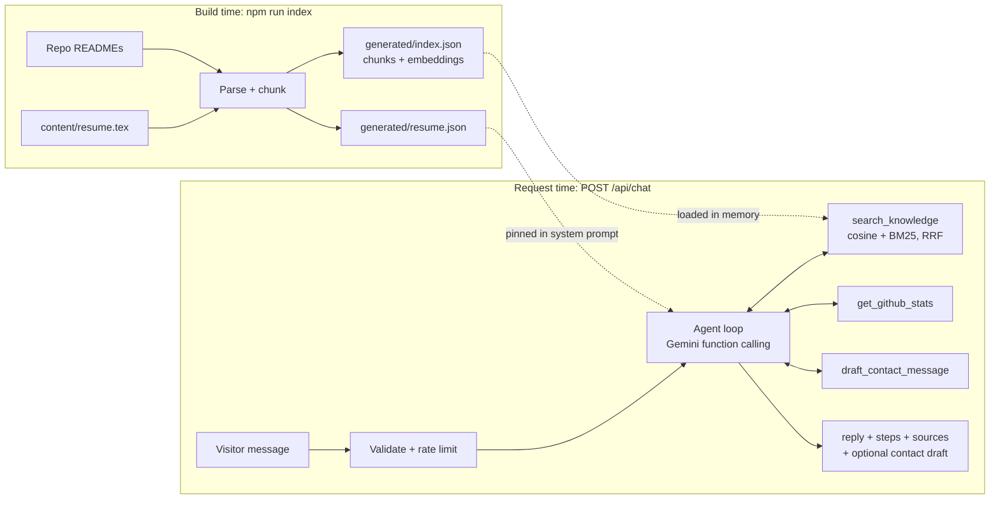

# Vamsi's Hub — A Discord-Styled Portfolio with an Agentic RAG Assistant

A personal portfolio for **Vamsi Garlapati** built to look and work like a Discord server. Visitors browse channels for education, experience, skills and projects, and can ask **vamsi-bot** anything about his background. The bot answers from his real resume and project READMEs, shows which tools it used, and cites its sources.

---

## What vamsi-bot does

- **Answers from sources, not a hardcoded prompt.** Knowledge comes from `content/resume.tex` and the READMEs of selected GitHub repos. Update the resume, run one script, and the bot knows.
- **Uses tools when it needs them.** It searches project READMEs, fetches live GitHub stats, and drafts contact messages.
- **Shows its work.** Each reply has a collapsible tool trace and source tags for the sources it cited.
- **Never sends anything on its own.** A contact request produces an editable draft card; the message is sent only when the visitor presses Send.
- **Stays on topic.** Off-topic questions and prompt-injection attempts get a polite redirect.
- **Has no database.** Embeddings are precomputed into a committed JSON file and searched in memory.

---

## Architecture



### 1. Ingestion (`npm run index`)

[`scripts/build-index.ts`](scripts/build-index.ts) reads the sources listed in [`content/sources.json`](content/sources.json):

- **Resume.** [`lib/rag/latex.ts`](lib/rag/latex.ts) parses the LaTeX into plain-text sections, with one chunk per job and per project.
- **READMEs.** [`lib/rag/chunk.ts`](lib/rag/chunk.ts) splits each README on headings, ignores `#` lines inside code fences, folds small subsections into their parent, and splits long sections on blank lines without cutting a table or code block. Every chunk starts with a breadcrumb such as `AI Travel Planner › Architecture › Data flow`.
- **Embeddings.** Chunks are embedded with `gemini-embedding-2` at 768 dimensions.

The script writes three committed files to `generated/`: `resume.json` (the resume as text), `index.json` (chunks and embeddings) and `corpus.md` (everything, used by the eval baseline).

### 2. Pinned resume + hybrid README retrieval

The resume is short, and nearly every question touches it, so the whole thing is placed in the system prompt. Questions about dates, titles, skills and metrics are answered with no tool call.

Project READMEs are much longer, so they are retrieved on demand. [`lib/rag/search.ts`](lib/rag/search.ts) runs two rankers over the in-memory index and merges them with reciprocal rank fusion:

- **Vector:** cosine similarity between the query embedding and each chunk.
- **Keyword:** BM25 via MiniSearch, with stop words removed, so exact names of libraries and functions are found reliably.

If the embedding call fails, search falls back to keyword-only results and tells the model.

### 3. Agent loop with tools

[`lib/agent/loop.ts`](lib/agent/loop.ts) drives Gemini function calling through a thin REST client, [`lib/gemini.ts`](lib/gemini.ts). Each model turn is appended to the conversation exactly as received, including thought signatures, and all tool results go back in a single turn. The loop is capped at five iterations; the last one runs without tools to force an answer.

| Tool | What it does |
| --- | --- |
| `search_knowledge` | Hybrid search over the indexed READMEs, optionally limited to one project |
| `get_github_stats` | Live stars, forks, languages and recent commits, for allowlisted repos only |
| `draft_contact_message` | Returns a draft for the UI to show; it cannot send |

The system prompt in [`lib/agent/prompt.ts`](lib/agent/prompt.ts) sets the rules: state facts at the level of detail the sources give, say so when something isn't covered, search before answering how or why questions about a project, and cite only the resume or sources a tool returned.

The route, [`app/api/chat/route.ts`](app/api/chat/route.ts), validates input, keeps the last 10 turns of history as plain text, caps messages at 1,000 characters, and applies a best-effort in-memory limit of 10 requests per minute per IP.

### 4. Evals (`npm run eval`)

[`evals/`](evals/) compares three designs on the same model with the same rules:

- **Hybrid agent:** the design described above.
- **Full context:** the resume and every README in the prompt, no tools.
- **Tools-only agent (v1):** the first design, which had to call a tool even to read the resume.

Grading is mostly deterministic: expected facts present, forbidden claims absent, correct refusals, and the right tool and source used. A separate judge model scores groundedness only. Answers are cached per case, so a run interrupted by a quota error resumes where it stopped.

The eval is versioned. **v1** is the three-way comparison above; its cases, checks and answers are frozen so its numbers stay comparable. **v2** measures changes made since then on the hybrid agent alone, and runs every case three times so that intermittent failures show up.

---

## Eval results

Results from eval v1, 21 answered cases on `gemini-3.5-flash-lite`, one run per case. The full report, including every disclosure and failing reply, is in [`evals/results.md`](evals/results.md); treat that file as the source of truth.

| Metric | Tools-only agent (v1) | Full context | Hybrid agent |
| --- | ---: | ---: | ---: |
| Cases passing all deterministic checks | 18/20 | 21/21 | 20/21 |
| Fact recall | 94% | 100% | 94% |
| Model calls per answer | 2.00 | 1.00 | 1.33 |
| Input tokens per answer | 3,818 | 12,525 | 3,745 |
| Median latency | 1.8 s | 1.2 s | 1.1 s |
| Estimated cost per 1,000 answers | $1.46 | $4.09 | $1.43 |

The hybrid agent's one failure was a wrong refusal: it gave the off-topic reply to an in-scope question about a freelance project. Repeating the question shows this happens intermittently. Groundedness judgements for the hybrid agent were still pending when this was written; see the report for their current state.

### Eval v2: the hybrid agent, three trials per case

After v1, two prompt rules were added: questions about anything on the resume are in scope even when the detail is missing, and acronyms are not expanded unless the source expands them. v2 re-runs the hybrid agent on 25 cases, three times each.

| Metric | Hybrid agent |
| --- | ---: |
| Trials passing all checks | 74/75 |
| Cases where all three trials passed | 24/25 |
| Off-topic refusals given to in-scope questions | 0 of 66 trials |
| Model calls per answer | 1.32 |

v2 uses stricter and broader checks than v1 and has no groundedness judge, so its numbers are not directly comparable with the table above.

### Retrieval on exact-term queries

Six queries that are each a single project-specific name, measured on the whole index with no model involved:

| Ranker | hit@1 | hit@3 | hit@5 |
| --- | ---: | ---: | ---: |
| Vector (cosine) | 2/6 | 2/6 | 4/6 |
| Keyword (BM25) | 6/6 | 6/6 | 6/6 |
| Hybrid (RRF) | 4/6 | 6/6 | 6/6 |

On 14 natural-language questions the two are close: vector search finds a relevant chunk in the top 3 for all 14 and the hybrid ranker for 13, and both reach 14 of 14 in the top 5. Hybrid search stays because it rescues the exact-term queries that vector search misses.

### Decision

The hybrid agent ships.

- **It fixed the first agent's failures.** The tools-only agent answered cross-cutting questions from a single search and missed half the picture. With the resume always in context, the hybrid passes those cases, and two thirds of its answers need no tool call.
- **It comes within one case of full context at under a third of the input tokens.**
- **It does what full context cannot:** live GitHub stats and contact drafts.

Full context is at least as accurate at this corpus size (it passed every case), and it uses fewer requests per answer, which is what a free-tier daily cap counts. It would be the simpler choice if the tools weren't wanted. The samples are small (21 cases, one run each), so this is a regression check rather than a benchmark.

---

## Tech stack

| Layer | Technology |
| --- | --- |
| Framework | Next.js 14 (App Router), TypeScript |
| Styling | Tailwind CSS, `@tailwindcss/typography` |
| Chat model | Google Gemini (`gemini-3.5-flash-lite` by default) with function calling |
| Embeddings | `gemini-embedding-2`, 768 dimensions |
| Keyword search | MiniSearch (BM25) |
| Storage | None; a committed JSON index searched in memory |
| Contact | Formspree |
| Hosting | Vercel |

---

## Project structure

```
.
├── app/
│   ├── api/chat/route.ts     # Validation, rate limit, runs the agent
│   ├── layout.tsx, page.tsx  # Shell and channel state
│   └── globals.css
├── components/
│   ├── ChatCanvas.tsx        # Channel feeds, bot chat, tool trace, draft card
│   └── ...Sidebar.tsx        # Server, channel and member rails
├── content/
│   ├── resume.tex            # The bot's source of truth
│   └── sources.json          # Repos whose READMEs are indexed
├── generated/                # Committed build output of `npm run index`
│   ├── index.json            # Chunks + embeddings
│   ├── resume.json           # Resume text for the system prompt
│   └── corpus.md             # All source text (eval baseline)
├── lib/
│   ├── gemini.ts             # REST client: generateContent, embeddings
│   ├── github.ts             # Live repo stats
│   ├── rate-limit.ts         # In-memory per-IP limiter
│   ├── data.ts               # Channel content shown in the UI
│   ├── agent/                # loop.ts, tools.ts, prompt.ts
│   └── rag/                  # latex.ts, chunk.ts, search.ts
├── scripts/                  # build-index.ts, search.ts, chat.ts
└── evals/
    ├── results.md            # Combined report: frozen v1, then v2
    ├── v1/, v2/              # Each suite's cases, cached runs and notes
    └── run.ts, run-v2.ts, grade.ts, systems.ts
```

The channels a visitor sees come from [`lib/data.ts`](lib/data.ts); what the bot knows comes from `content/`. Change both when the resume changes.

---

## Getting started

```bash
npm install
cp .env.local.example .env.local   # then fill in the values
npm run dev                        # http://localhost:3000
```

### Environment variables

| Variable | Required | Purpose |
| --- | --- | --- |
| `GEMINI_API_KEY` | Yes | Chat and embedding calls. Server-only. |
| `NEXT_PUBLIC_FORMSPREE_ENDPOINT` | For contact | Where the contact form and draft card send messages |
| `GEMINI_MODEL` | No | Overrides the chat model (default `gemini-3.5-flash-lite`) |
| `JUDGE_MODEL` | No | Eval judge model (default `gemini-4-hydrogen`); must differ from the chat model |
| `GITHUB_TOKEN` | No | Raises the GitHub API limit above 60 requests per hour; needs no scopes |

### Scripts

| Command | What it does |
| --- | --- |
| `npm run dev` / `build` / `start` | The Next.js app |
| `npm run index` | Rebuild `generated/` from `content/`. Add `-- --dry-run` to print chunks without calling the API |
| `npm run search -- "query"` | Show vector, keyword and hybrid rankings side by side |
| `npm run chat -- "question" "follow-up"` | Talk to the agent from the terminal |
| `npm run eval` | Run missing eval v2 trials and rewrite `evals/results.md` |
| `npm run eval:v1` | Fill in pending judgements for the frozen v1 eval; never generates answers |
| `npm run typecheck` | `tsc --noEmit` |

### Updating what the bot knows

1. Edit `content/resume.tex`, or add a repo to `content/sources.json`.
2. Run `npm run index` and commit the changed files in `generated/`.
3. Update `lib/data.ts` if the channels should change too.

---

## Deployment

Import the repo into Vercel, set the environment variables above under **Settings → Environment Variables**, and deploy. The index is committed, so no build step calls the embedding API.

---

## Known limitations

- **Free-tier quotas are small.** Gemini's free tier caps requests per day per model, and each answer costs one to three model calls. When the quota runs out the bot says so and points to the contact form.
- **The rate limiter is per server instance.** It resets on a cold start and is not shared across instances, so it slows casual abuse rather than enforcing a global cap.
- **Source tags depend on the model's source line.** A source is tagged only when the reply's closing source line names it.
- **The eval is small.** v1 has 21 cases and one run each; v2 has 25 cases and three runs each. A difference of one case is noise.

---

Built by Vamsi Garlapati.
